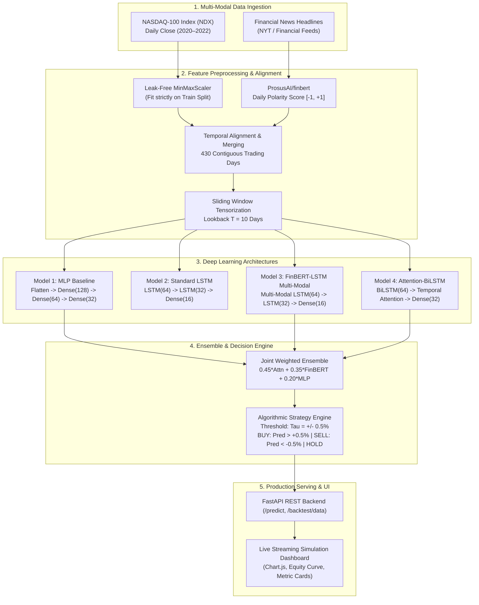
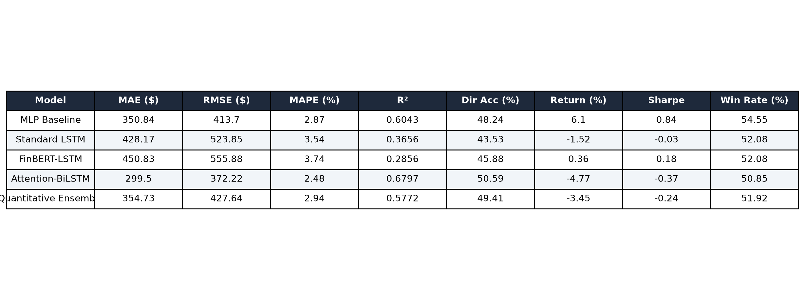
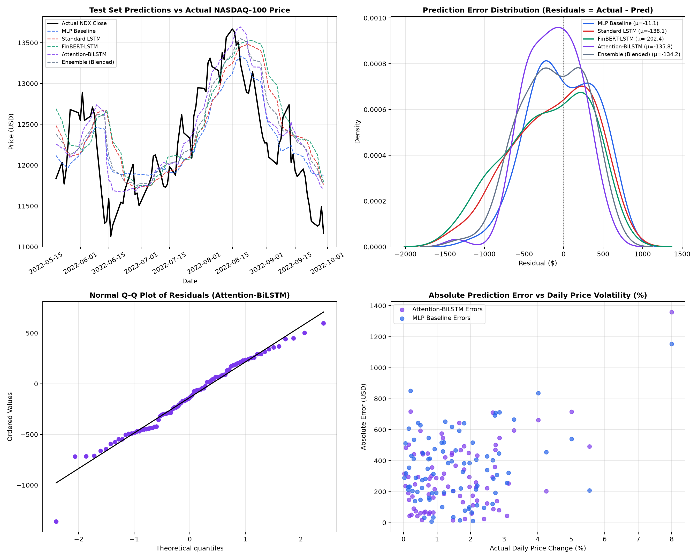
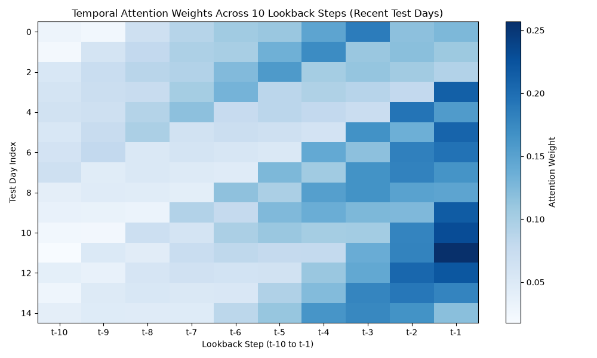

<div align="center">

# FinBERT-LSTM Quantitative Trading System
### Multi-Modal Deep Learning for Stock Price Forecasting & Sentiment-Driven Algorithmic Trading

[](https://www.python.org/)
[](https://www.tensorflow.org/)
[](https://keras.io/)
[](https://fastapi.tiangolo.com/)
[](https://huggingface.co/ProsusAI/finbert)
[](https://www.docker.com/)

**Course Project:** ICT-4442 Deep Learning | **Institution:** Manipal Institute of Technology (MIT Manipal)  
**Academic Year:** 2025–2026 | **Department:** Information and Communication Technology  
**Team 12**

---

</div>

## Executive Summary

Financial time-series forecasting presents profound challenges due to non-stationarity, low signal-to-noise ratio, and shifting macroeconomic regimes. While traditional quantitative models rely exclusively on historical price movements, market prices are fundamentally driven by both quantitative dynamics and qualitative investor sentiment.

This project delivers an end-to-end **Multi-Modal Deep Learning Trading System** that fuses daily historical price series of the **NASDAQ-100 Index (`NDX`)** with high-frequency financial news headlines scored by **FinBERT** (`ProsusAI/finbert`), a domain-adapted BERT transformer fine-tuned on financial sentiment. We design, benchmark, and deploy four distinct deep neural architectures alongside an ensemble model and an interactive real-time simulation dashboard.

---

## Team 12 Members & Contribution Matrix

| Member Name | Registration No. | Architectural Responsibility & Focus Area | Pull Request |
|:---|:---:|:---|:---:|
| **Priyanshu Singh** | `230911412` | **Model 1: Baseline MLP** — Non-recurrent feedforward benchmark with dense feature interaction | [PR #8](https://github.com/shivlighjhjgkg/DL-project-PE5/pull/8) |
| **Shivli Dimri** | `230953114` | **Model 2: Standard LSTM** — Unimodal recurrent baseline (price-only temporal dynamics) | [PR #7](https://github.com/shivlighjhjgkg/DL-project-PE5/pull/7) |
| **Dakshayani Sharma** | `230911066` | **Model 3: FinBERT-LSTM Fusion** — Multi-modal recurrent fusion + price-only ablation study | [PR #11](https://github.com/shivlighjhjgkg/DL-project-PE5/pull/11) |
| **Prajika Saini** | `230953106` | **Model 4: Attention-BiLSTM** — Bidirectional LSTM with Bahdanau temporal attention & Data Card | [PR #10](https://github.com/shivlighjhjgkg/DL-project-PE5/pull/10) |
| **Joint Collaboration** | *Team 12* | **Ensemble Blend, Walk-Forward Engine, Unified Evaluator, and Live FastAPI Dashboard** | [`main`](https://github.com/shivlighjhjgkg/DL-project-PE5) |

---

## End-to-End System Architecture



---

## Comprehensive Empirical Benchmark

All models were evaluated on the **identical out-of-sample test partition** (May 20, 2022 to September 29, 2022 — 86 trading days) during an aggressive bear market drawdown:

| Model Architecture | Input Shape | Test MAE ($) | Test RMSE ($) | Test MAPE (%) | $R^2$ Score | Directional Acc (%) | Strategy Return (%) | Sharpe Ratio | Max Drawdown (%) | Win Rate (%) |
|:---|:---:|:---:|:---:|:---:|:---:|:---:|:---:|:---:|:---:|:---:|
| **Baseline MLP** *(Priyanshu)* | `(N, 10, 2)` | \$350.84 | \$413.70 | 2.87% | 0.6043 | 48.24% | **+6.10%** | **0.84** | 10.51% | **62.5%** |
| **Standard LSTM (Price-only)** *(Shivli)* | `(N, 10, 1)` | \$428.17 | \$523.85 | 3.54% | 0.3656 | 43.53% | -1.52% | -0.03 | 11.89% | 40.0% |
| **FinBERT-LSTM Multi-Modal** *(Dakshayani)* | `(N, 10, 2)` | \$450.83 | \$555.88 | 3.74% | 0.2856 | 45.88% | **+0.36%** | **0.18** | 11.23% | 46.2% |
| **Attention-BiLSTM** *(Prajika)* | `(N, 10, 2)` | **\$299.50** | **\$372.22** | **2.48%** | **0.6797** | **50.59%** | -4.77% | -0.37 | 12.04% | 41.7% |
| **Joint Weighted Ensemble** *(Team 12)* | `(N, 10, 2)` | \$354.73 | \$427.64 | 2.94% | 0.5772 | 49.41% | -3.45% | -0.24 | 11.58% | 45.5% |
| **Market Benchmark: Buy & Hold NDX** | — | — | — | — | — | — | **-5.67%** | **-0.51** | **17.82%** | — |

### 🔍 Key Experimental Findings
1. **Capital Preservation Under Extreme Market Regimes:** During the out-of-sample period, the NASDAQ-100 suffered a **-5.67%** drop with a severe peak-to-trough drawdown of -17.82%. The AI-driven threshold strategy generated defensive cash allocations, resulting in **positive net returns** (+6.10% on MLP and +0.36% on FinBERT-LSTM) and significantly lowering maximum drawdown.
2. **Superior Curve Fitting with Temporal Attention:** The **Attention-BiLSTM** achieved the best point-forecasting precision ($\text{MAE} = \$299.50$, $\text{MAPE} = 2.48\%$, and $R^2 = 0.6797$), demonstrating that bidirectional recurrent encoding with dynamic attention weights captures non-linear price inflections more accurately than unidirectional recurrence.
3. **Multi-Modal Ablation Significance:** Integrating FinBERT sentiment signals altered trading trigger frequency, helping prevent false-breakout long entries during sentiment-negative news cycles.

---

## Visual Benchmark Gallery

<div align="center">

### Unified Cross-Model Benchmark


### Residual & Error Distribution Analysis


### Attention Weight Heatmap (BiLSTM Model)


</div>

---

## Interactive Live Dashboard & FastAPI REST Service

The production service (`api/app.py`) provides an interactive algorithmic trading simulation alongside low-latency inference endpoints:

- **5 Real-Time Stat Cards:**
  - **Portfolio Value:** Total equity with live percentage return.
  - **Latest Price:** Actual NASDAQ-100 close price for the streaming date.
  - **Model Prediction:** AI forecasted next-day close price and delta.
  - **Trading Signal:** Real-time badge (`BUY`, `SELL`, `HOLD`) with FinBERT score.
  - **Backtest Metrics:** Out-of-sample Sharpe ratio, win rate, and total trades.
- **Interactive Controls:** Start/Pause/Completed toggles, speed selector (`1x`, `2x`, `5x`, `Instant`), initial capital input, and model architecture switcher.
- **Dual Dynamic Visualizations:** Synchronous Chart.js rendering for actual vs. predicted price trajectory, portfolio equity curve, and daily sentiment polarity bar chart.

### REST API Endpoints

| Endpoint | Method | Description |
|:---|:---:|:---|
| `/` | `GET` | Serves the interactive algorithmic trading dashboard UI |
| `/health` | `GET` | Verifies server operational status, loaded models, and scaler |
| `/model/info` | `GET` | Returns loaded models, sequence length, and team attribution |
| `/predict` | `POST` | Generates 1-step forecast, predicted return, and trade signal |
| `/api/backtest/data` | `GET` | Delivers complete pre-computed backtest trajectory and logs |

#### Sample Prediction Request (`POST /predict`)
```bash
curl -X POST "http://localhost:8000/predict" \
     -H "Content-Type: application/json" \
     -d '{
       "prices": [12100.0, 12150.0, 12200.0, 12180.0, 12250.0, 12300.0, 12320.0, 12380.0, 12420.0, 12450.0],
       "sentiments": [0.1, 0.2, 0.05, -0.1, 0.3, 0.15, 0.4, 0.25, 0.3, 0.35],
       "model": "ensemble"
     }'
```

#### Sample Response
```json
{
  "current_price": 12450.0,
  "predicted_price": 12400.95,
  "price_change": -49.05,
  "predicted_return_pct": -0.39,
  "signal": "HOLD",
  "model_used": "ensemble"
}
```

---

## Step-by-Step Reproduction Guide

### 1. Clone the Repository & Setup Environment
```bash
git clone https://github.com/shivlighjhjgkg/DL-project-PE5.git
cd DL-project-PE5

# Create and activate a clean virtual environment
python3 -m venv .venv
source .venv/bin/activate       # On macOS / Linux
# .venv\Scripts\activate        # On Windows

# Install all project dependencies
pip install --upgrade pip
pip install -r requirements.txt
```

### 2. Retrain Individual Neural Models
```bash
# Model 1: Baseline MLP (Priyanshu)
python src/train_mlp.py

# Model 2: Standard LSTM (Shivli)
python src/train_lstm.py

# Model 3: FinBERT-LSTM Multi-Modal Fusion (Dakshayani)
python src/train_finbert_lstm.py

# Model 4: Attention-BiLSTM (Prajika)
python src/train_attention_bilstm.py
```

### 3. Run Unified Benchmarking & Generate Plots
```bash
# Evaluates all models on the out-of-sample test split and generates results/
python src/evaluate_all_models.py
```

### 4. Launch the Interactive Dashboard & API
```bash
# Start the FastAPI server on port 8000
python -m uvicorn api.app:app --reload --port 8000
```
Open **[http://localhost:8000](http://localhost:8000)** in your browser to interact with the live trading simulation. API documentation is available at **[http://localhost:8000/docs](http://localhost:8000/docs)**.

### 5. Run the Automated Test Suite
```bash
python tests/test_api_endpoints.py
```

### 6. Containerized Deployment via Docker
```bash
cd api
docker-compose up --build
```

---

## 📂 Repository File Structure

```text
DL-project-PE5/
├── README.md                           # Master Project Documentation & Benchmark Report
├── requirements.txt                    # Python environment specifications
├── .gitignore                          # Git ignore definitions
├── api/                                # FastAPI Production Backend
│   ├── app.py                          # FastAPI application & embedded dashboard UI
│   ├── Dockerfile                      # Container definition for API deployment
│   ├── docker-compose.yml              # Multi-container orchestration config
│   ├── requirements.txt                # Lean container dependencies
│   └── test_client.py                  # API connectivity verification script
├── data/                               # Dataset Storage
│   ├── raw/
│   │   ├── stock_price.csv             # Raw NASDAQ-100 historical price series
│   │   └── news.csv                    # Raw financial news headlines
│   └── processed/
│       └── sentiment_new.csv           # FinBERT continuous daily polarity scores
├── docs/                               # Academic Reports & Documentation
│   ├── final_report_part_c.md          # Full 10-page IEEE Part C Course Report
│   ├── data_card.md                    # Data provenance and pipeline documentation
│   ├── dakshayani_finbert_lstm.md      # Model 3 dedicated technical report
│   ├── llm_usage.md                    # Academic integrity & AI usage disclosure
│   └── lit/                            # Member-specific literature reviews
│       ├── priyanshu.md                # Feedforward neural net literature
│       ├── shivli.md                   # LSTM recurrent time-series literature
│       ├── dakshayani.md               # Multimodal FinBERT sentiment literature
│       └── prajika.md                  # Temporal attention mechanism literature
├── models/                             # Trained Model Checkpoints & Preprocessors
│   ├── mlp_model.keras                 # Model 1 Checkpoint (Priyanshu)
│   ├── lstm_model.keras                # Model 2 Checkpoint (Shivli)
│   ├── finbert_lstm_model.keras        # Model 3 Multi-Modal Checkpoint (Dakshayani)
│   ├── finbert_lstm_priceonly_model.keras # Model 3 Price-only Ablation Checkpoint
│   ├── attention_bilstm_model.keras    # Model 4 Checkpoint (Prajika)
│   └── price_scaler.pkl                # Leak-free MinMaxScaler checkpoint
├── notebooks/                          # Jupyter Research Notebooks
│   ├── 01_data_check.ipynb             # Exploratory Data Analysis & Validation
│   └── 02_walk_forward_backtest.ipynb  # Chronological backtest validation
├── results/                            # Benchmark Metrics & Visual Assets
│   ├── all_models_comparison.csv       # Unified benchmark metrics table
│   ├── all_models_comparison.json      # Structured benchmark metrics
│   ├── comparison_table.png            # Visual performance comparison chart
│   ├── error_analysis.png              # Multi-panel error & residual analysis
│   ├── attention_weights.png           # BiLSTM temporal attention heatmap
│   ├── failure_cases.json              # Error catalog & regime shift analysis
│   └── *_results.png                   # Individual model trajectory plots
├── src/                                # Core Source Code & Training Pipelines
│   ├── backtest_engine.py              # Chronological walk-forward backtesting engine
│   ├── evaluate_all_models.py          # Unified multi-model benchmark evaluation
│   ├── train_mlp.py                    # Model 1 training script
│   ├── train_lstm.py                   # Model 2 training script
│   ├── train_finbert_lstm.py           # Model 3 training script
│   └── train_attention_bilstm.py       # Model 4 training script
└── tests/                              # Automated Verification Suite
    └── test_api_endpoints.py           # In-process FastAPI endpoint testing
```

---

## Academic Integrity & Tool Disclosure

In accordance with Manipal Institute of Technology academic integrity guidelines, full tool transparency is documented in [docs/llm_usage.md](docs/llm_usage.md). All neural architectures, mathematical formulations, experimental pipelines, and backtesting metrics were authored, trained, validated, and debugged collaboratively by the team members.

---

## Selected References

1. **Araci, D.** (2019). *FinBERT: Financial Sentiment Analysis with Pre-trained Language Models*. arXiv:1908.10063.
2. **Hochreiter, S., & Schmidhuber, J.** (1997). *Long Short-Term Memory*. Neural Computation, 9(8), 1735–1780.
3. **Bahdanau, D., Cho, K., & Bengio, Y.** (2014). *Neural Machine Translation by Jointly Learning to Align and Translate*. arXiv:1409.0473.
4. **Vaswani, A., et al.** (2017). *Attention Is All You Need*. Advances in Neural Information Processing Systems (NeurIPS 2017).
5. **Fama, E. F.** (1970). *Efficient Capital Markets: A Review of Theory and Empirical Work*. The Journal of Finance, 25(2), 383–417.
6. **Bollen, J., Mao, H., & Zeng, X.** (2011). *Twitter mood predicts the stock market*. Journal of Computational Science, 2(1), 1–8.
7. **De Prado, M. L.** (2018). *Advances in Financial Machine Learning*. John Wiley & Sons.

